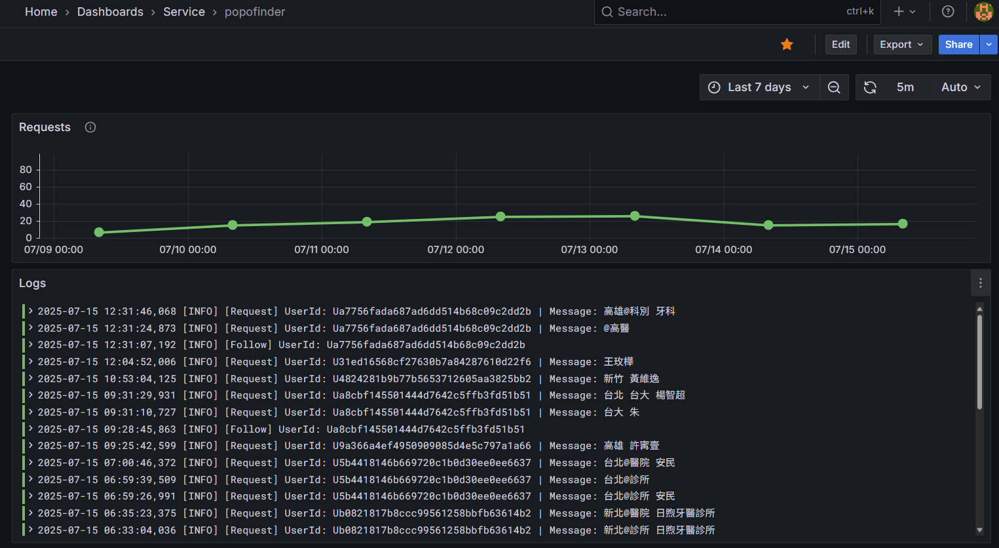

# POPO Finder

查詢台灣醫師學歷的 LINE bot。收錄醫療院所官網、網路公開彙整與民眾回報的醫師學歷，台灣與國外畢業的都有；卡片照實顯示學歷與資料來源，不做任何判斷。

資料來源：醫療院所官網、[波波一覽表](https://popolist999.blogspot.com/)（網路公開彙整）、民眾回報

## 加入 QR code 與連結

[點擊我加入好友](https://lin.ee/h1GxF9s)

## 使用範例

### 幫助

### 地區醫院查詢

### 地區科別詢

## Grafana
此專案搭配自建的 grafana, promethus, loki 並自製 dashboard 進行 Monitor

